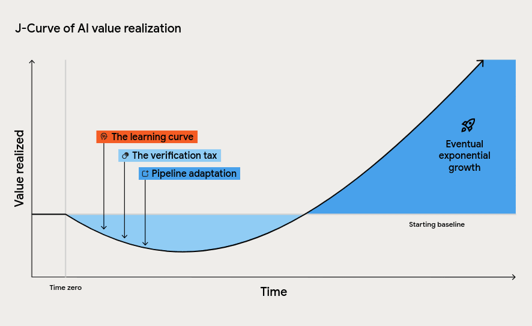
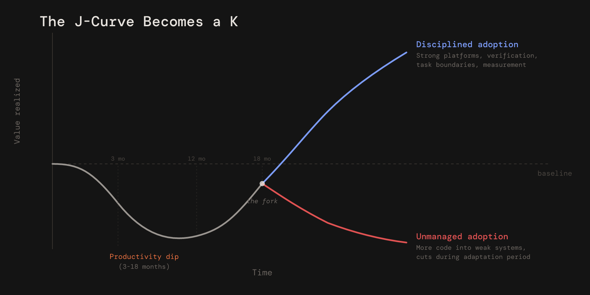

Which single number in an AI business case can turn a first-year win into a first-year loss?  It isn't model cost, salary, or adoption rate.  It's how long the productivity dip lasts.

[DORA](https://dora.dev) is Google Cloud's *DevOps Research and Assessment* program, the research group behind the delivery metrics many engineering organizations benchmark against.  Its [ROI report](https://dora.dev/ai/roi/report/) on AI-assisted software development comes with a calculator, and the sample model assumes a three-month dip.  On that assumption, a 500-person engineering organization produces a first-year benefit of roughly $3.3 million, a 39% ROI, and a payback period under a year.  [Faros AI](https://www.faros.ai/blog/dora-ai-roi-calculator-telemetry-inputs) stress-tested the same calculator with a twelve-month dip.  The same organization went from a $3.3 million first-year gain to a $6.6 million loss.  That's a $9.9 million swing from one input.

The report is a serious attempt at a hard management question, and it names a pattern many practitioners already feel.  AI adoption follows a *J-curve*: productivity drops before it rises.

DORA's explanation for the dip holds up.  Teams spend time learning new workflows.  Developers have to review AI-generated code, because trust isn't free.  Everything downstream (review, test, security, CI/CD, incident response) has to absorb more output.  The report calls this "the tuition cost of transformation."

So the framing is useful, and the default timeline is the dangerous part.  Does the dip last three months, twelve months, or long enough that leadership cuts funding or headcount before the organization has made the investments the upside depends on?

DORA studies software, but the same thing happens wherever AI enters production work, from analytics pipelines to customer operations.  AI raises the volume of output before the organization has upgraded the systems that check and absorb it.  Code is just the most instrumented version of the story.

## DORA is right about the mechanism

DORA's strongest idea is the amplifier thesis, more than the calculator.  In its [2025 State of AI-Assisted Software Development](https://dora.dev/research/2025/dora-report/) report, DORA argued that AI amplifies the organizational conditions it lands in.  Strong engineering systems get stronger, and weak ones get faster at producing dysfunction.

An organization with strong automated tests, fast CI, disciplined review, observable production systems, and a mature developer platform can absorb AI-generated output.  An organization without those foundations gets larger pull requests, more review pressure, more rework, and more incidents downstream of the dashboard celebrating "AI adoption."

That asymmetry is what the sample assumptions understate.  Faros's telemetry-informed scenario, which combines a longer adaptation period with quality degradation, also produces a negative first-year ROI.  Faros is a vendor analyzing its own customer base, so this isn't a population-representative causal study.  It doesn't have to be to make the management point.  The return is highly sensitive to how long and how deep the trough runs, and a leadership team that treats DORA's default as a forecast will under-budget the hard part.

## How long does the dip really last?

Based on the evidence below, my working estimate is twelve to eighteen months, not three.

Months one through six are the calibration phase.  Developers learn where AI helps, where it lies, and how to review its output.  Productivity may look flat or negative if you measure verified delivery rather than code volume.

Months six through twelve are the pipeline phase.  Review, testing, security, CI/CD, observability, and incident response adapt to increased generation capacity.  Leading indicators should improve even if aggregate ROI is still mixed.

Months twelve through eighteen are the crossover phase.  If the leading indicators are improving, the organization should begin to see durable gains: higher deployment frequency without higher change failure, lower lead time without more incidents, and better developer experience without quality erosion.

## The evidence does not tell one story

Why do serious studies of AI coding productivity disagree?  They're measuring different work under different conditions.

DORA's own [2024 data](https://cloud.google.com/blog/products/devops-sre/announcing-the-2024-dora-report) showed the tension early.  A 25% increase in AI adoption was associated with a 1.5% decrease in delivery throughput and a 7.2% decrease in delivery stability, even as perceived code quality and code review speed went up.

[METR](https://metr.org)'s [controlled experiment](https://metr.org/blog/2025-07-10-early-2025-ai-experienced-os-dev-study/) made that perception gap explicit.  Sixteen experienced developers completed 246 tasks in their own open-source repositories, randomly assigned to use or not use AI tools.  With AI, they took 19% longer.  Afterward, they still believed AI had sped them up by about 20%.  The slowdown matters less than the misreading, because these developers couldn't see their own productivity.  The sample was small and the work was complex, and METR has since published a [follow-up noting that a later experiment produced an unreliable estimate](https://metr.org/blog/2026-02-24-uplift-update/), so the slowdown isn't a universal law.

A larger field experiment by [Cui et al.](https://www.microsoft.com/en-us/research/publication/the-effects-of-generative-ai-on-high-skilled-work-evidence-from-three-field-experiments-with-software-developers/), run across Microsoft, Accenture, and an anonymous Fortune 100 company, found a 26% increase in completed tasks among 4,867 developers using an AI coding assistant.  The effects were stronger for newer and more junior employees.

How can both be true?  AI helps more when the task is bounded, the context is legible, and the developer has less accumulated domain-specific advantage.  It helps less, and can hurt, when the work needs deep local context, architectural judgment, and careful integration into a complex codebase.  Most enterprise engineering is the second kind: legacy systems, migrations, security constraints, test gaps, and half-documented business rules.  AI is very good at producing plausible code, and the enterprise problem is verified, maintainable, production-safe change.

The telemetry shows the same tradeoff at scale.  In [Faros AI](https://www.faros.ai/blog/dora-ai-roi-calculator-telemetry-inputs)'s analysis of 22,000 developers across 4,000 teams, task throughput per developer rose 33.7% and epics per developer rose 66.2%.  Incidents per pull request rose 242.7% and bugs per developer rose 54%.  [Sonar](https://www.sonarsource.com)'s [2026 developer survey](https://www.sonarsource.com/resources/developer-survey-report/) found that 96% of developers don't fully trust AI-generated code, yet only 48% say they always verify it before committing.

Read both as signal rather than proof.  This is vendor data from companies with a commercial interest in surfacing problems, and none of it is a randomized trial.  It's still consistent with what the controlled studies suggest.

**When code volume rises faster than review capacity, test coverage, and security scanning, the system gets less stable even while individual developers feel faster.**

## The verification tax is not temporary

Call the cost of checking AI output before you can trust it the *verification tax*.  Won't it shrink once developers get used to the tools?  Some of it will.  Prompting improves, tooling improves, and developers learn where AI is useful and where it's dangerous.  The core of the tax is structural, though.

AI-generated code has no human intent behind it the way a teammate's code does.  It can be clean and idiomatic while being semantically wrong.  It can pass local tests while violating an invariant that lives in a different service, a customer workflow, or an undocumented operational constraint.  That makes review harder.

The open-source world is already reacting.  *Curl* [ended its HackerOne bug bounty program](https://daniel.haxx.se/blog/2026/01/26/the-end-of-the-curl-bug-bounty/) after a flood of low-quality, AI-generated vulnerability reports overwhelmed maintainers.  *NetBSD* [treats LLM-generated code as "tainted"](https://www.netbsd.org/developers/commit-guidelines.html) unless core developers approve it, and *Gentoo* [banned AI-generated contributions](https://www.theregister.com/2024/04/16/gentoo_linux_bans_code_contributions_written_with_ai/).  The Linux kernel [permits AI-assisted work](https://docs.kernel.org/process/coding-assistants.html) but puts full responsibility on the human submitter.  These are maintenance systems defending scarce review capacity, and enterprise engineering has the same problem inside the firewall.

What happens if AI increases generation capacity by 2x but verification capacity by only 1.1x?  The bottleneck moves.  The organization doesn't become twice as productive.  It becomes review-bound, test-bound, security-bound, and incident-bound, which is why code volume is a dangerous success metric.

## This has happened before

*Paul David*'s 1990 paper, ["The Dynamo and the Computer,"](https://www.jstor.org/stable/2006600) explained why electrification took decades to show up in factory productivity.  Early factories overlaid electric motors onto steam-era layouts.  They replaced the power source and kept the old organization of work.  The payoff came later, when factories were redesigned around electricity.

*Brynjolfsson*, *Rock*, and *Syverson* formalized the mechanism as the ["Productivity J-Curve."](https://www.aeaweb.org/articles?id=10.1257/mac.20180386)  General-purpose technologies such as AI need complementary investments in process redesign, human capital, and organizational restructuring, and those are poorly measured while they're being made.  Productivity can look flat or negative during the investment phase, then overshoot once the new system starts compounding.

That's the economics behind DORA's J-curve.  What it leaves out is that the curve doesn't resolve the same way for everyone.  Some organizations invest through the trough and come out with higher throughput, stronger platforms, and faster learning loops.  Others read the trough as evidence that AI failed, or use AI output to justify cutting the very people needed to verify and integrate it.  That's how the J becomes a K.

## The upper branch is not just "more AI"

What separates the companies moving up the curve?  They're redesigning the delivery system around AI, which is a different job from buying more licenses.

AWS offers the best measurement lesson.  [AWS reported a 15.9% year-over-year reduction in software development cost](https://aws.amazon.com/blogs/enterprise-strategy/business-value-of-developer-experience-improvements-amazons-15-9-breakthrough/) using its *Cost to Serve Software* framework.  "Amazon Q saved 15.9%" would be too clean a reading.  AWS measured the whole software delivery system: deployments per builder, human interventions, incidents per deployment, and cost-to-serve.  AI was one part of a broader developer-experience and operational-efficiency program.

The survey data points the same way.  [McKinsey](https://www.mckinsey.com)'s [2025 State of AI survey](https://www.mckinsey.com/capabilities/quantumblack/our-insights/the-state-of-ai) found that 88% of organizations use AI in at least one business function, but only about 6% qualify as AI high performers, meaning they attribute 5% or more EBIT impact to AI and report significant value.  Those high performers are more likely to redesign workflows, define when model outputs require human validation, and have senior leaders actively engaged in adoption.  Adoption is becoming common while impact stays concentrated.

So the upper branch is disciplined adoption: strong platforms, explicit verification, clear use-case boundaries, measurement beyond code volume, and leadership willing to fund the adaptation period.

## The lower branch is not "no AI"

The lower branch can have plenty of AI.  *Klarna* is the canonical warning.  In February 2024, [Klarna announced that its AI assistant handled 2.3 million conversations](https://www.klarna.com/international/press/klarna-ai-assistant-handles-two-thirds-of-customer-service-chats-in-its-first-month/), about two-thirds of customer-service chats, doing work equivalent to 700 full-time agents.  By 2025, [Klarna was bringing humans back into customer service](https://www.customerexperiencedive.com/news/klarna-reinvests-human-talent-customer-service-AI-chatbot/747586/), with CEO *Sebastian Siemiatkowski* acknowledging that the company had over-indexed on cost and needed to course-correct on quality.  Klarna's AI clearly did something.  The volume metrics masked quality degradation in the interactions where quality mattered most.

*Freshworks* is a different warning.  In May 2026, [Freshworks announced it would cut roughly 500 jobs](https://qz.com/freshworks-layoffs-500-jobs-ai-code-earnings-050626), about 11% of its workforce, while CEO *Dennis Woodside* said more than half of the company's code was written by AI.  That may prove financially rational.  Could it also be the failure mode DORA warns against, reducing human capacity in the period when AI-generated output raises the need for verification, architectural judgment, and production accountability?

What defines the lower branch is unmanaged adoption, and it can coexist with very high usage.

Can a late mover still catch up?  Cloud is the strongest precedent for yes.  Cloud adoption also looked divergent at first, and late movers caught up once the playbook became legible: DevOps, CI/CD, infrastructure-as-code, platform teams.  AI may follow the same path.  The difference is that cloud was mostly an infrastructure migration, difficult but codifiable.  AI-assisted development depends on trust calibration, review heuristics, task decomposition, and risk classification, which can be taught but can't simply be installed.  That learning compounds for the organizations already doing it.  The catch-up window is open, but it isn't passive.

## How would you know which branch you're on?

The developers in the METR study couldn't feel their own slowdown, so the answer has to come from instrumentation.  "Percentage of code written by AI" won't tell you.  It's a volume metric, and it can rise while quality, security, and stability fall.  Measure these instead, each broken out by whether the change was AI-assisted or human-authored.

*Change failure rate.*  If AI-assisted changes fail materially more often, the bottleneck is verification, not adoption.

*Incident rate per pull request.*  [Faros AI](https://www.faros.ai/blog/dora-ai-roi-calculator-telemetry-inputs) found incidents per PR rising sharply after AI adoption.  Your number matters more than Faros's number, so instrument it.

*Review time and review depth.*  If AI-assisted PRs wait longer, require more review cycles, or get merged with less scrutiny, you have a control problem.

*Rework and churn.*  Track how often code is modified, reverted, or deleted within 30 days of merge.  [GitClear](https://www.gitclear.com)'s [work on AI-era code quality](https://www.gitclear.com/ai_assistant_code_quality_2025_research) points toward higher churn, more duplicated code, and less refactoring as AI coding assistants spread.

Usage numbers like accepted suggestion rate only become useful when paired with these outcomes and with security findings.

## Closing: the upside belongs to the disciplined

DORA's core insight is right: AI amplifies the system it enters.  That's why the dip matters.  It's the period when an organization shows whether it can make the complementary investments AI requires.  Some will use AI to build stronger delivery systems.  Others will ship more code into weak ones, or cut people before they've upgraded verification.  Which of those is your organization funding right now?

The tempting thesis is "AI writes code, therefore we need fewer engineers."  The one the evidence supports is "AI increases generation capacity, therefore we must upgrade the delivery system."  DORA's 39% sample ROI is the optimistic case, and it belongs next to the sensitivity case whenever it's presented as a forecast.

The tuition is real, but paying tuition is not the same as graduating.  The organizations that finish the course won't be the ones that generated the most code.  They'll be the ones that learned how to verify, integrate, operate, and improve at AI speed without losing the human judgment that makes the output worth anything.
